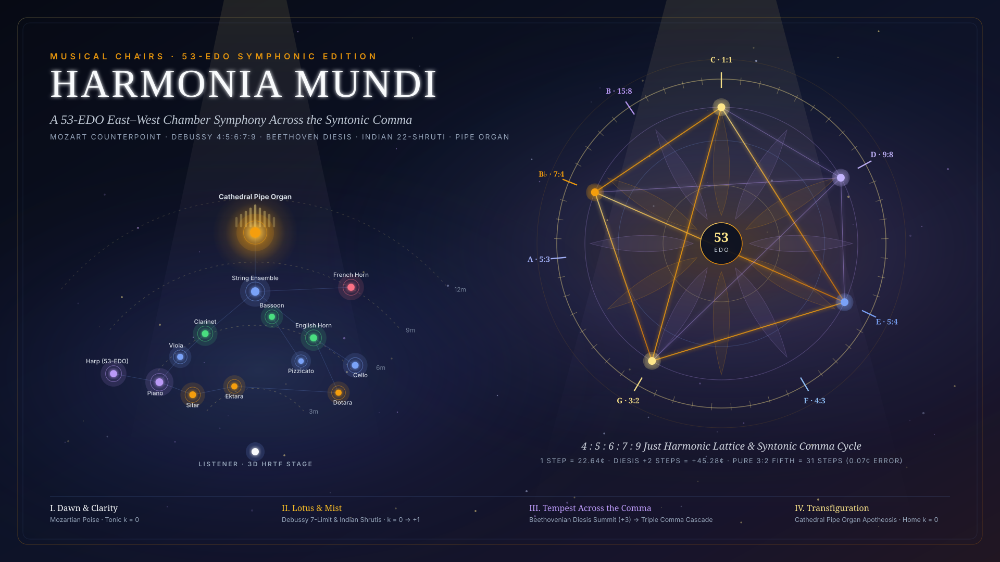
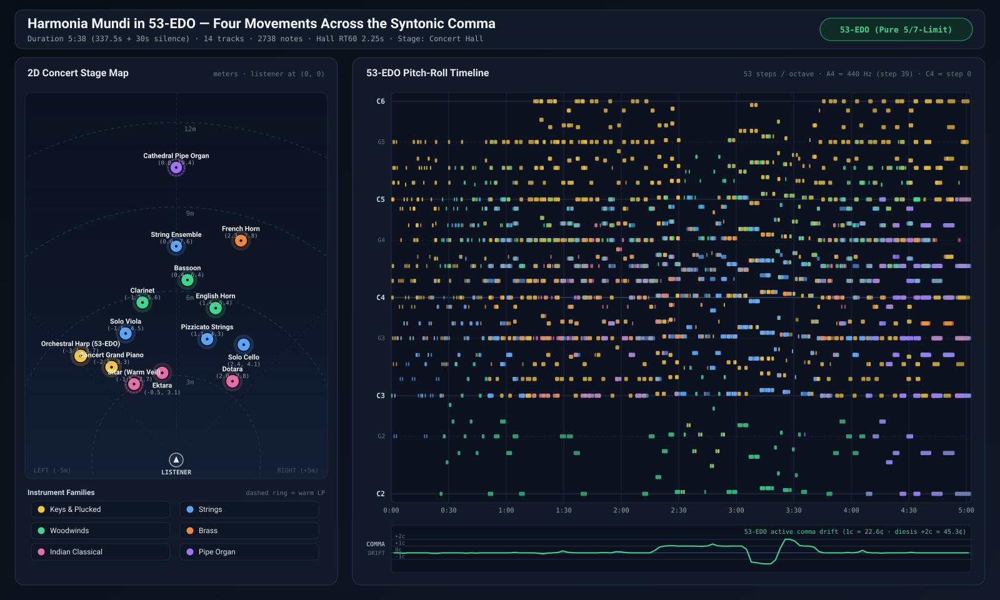

# Musical Chairs

A pure-Rust **53-EDO (53 Equal Divisions of the Octave)** microtonal classical music, virtual concert-stage & animated video engine — decouple pure musical scores (`score.json`) from physical 3D concert-hall seating (`stages/*.json`), compare **53-EDO vs 12-TET** on the exact same score, visualize any piece as a crisp SVG, and render YouTube-ready **1080p VP9 + Opus WebM** concert videos.



---

## Highlights

- **Decoupled 2-Input Architecture (`score.json` + `--stage stage.json`):** Compose pure, stage-independent 53-EDO music once and re-seat the orchestra across reusable concert stages (`stages/concert_hall.json`, `stages/intimate_circle.json`, `stages/east_west_split.json`).
- **Exact 53-EDO Tuning & Instant 12-TET Comparison (`--tuning 53edo|12tet`):** Pure 5-limit triads (`[0, 17, 31]` within 1.4¢ of 4:5:6), Debussy 7-limit harmonic ninths (`4:5:6:7:9`), Indian 22-shruti pitches, chromatic-mediant diesis modulations (`+2`), and seamless 5-limit comma pumps (`±1`) — or quantize any score to 12-TET with `--tuning 12tet` to hear the difference directly.
- **19 SoundFont2 Instruments + 2 Physical Models:** 15 dedicated melodic MIDI channels per SF2 track (`rustysynth` + a user-supplied GM SoundFont) for collision-free 14-bit pitch bend, CC 11 wind breath swells, and meend glides — paired with physically modeled **Ektara** and **Dotara** in pure Rust (`src/indian.rs`).
- **Physical 3D Concert Stage & Hall Reverb:** Woodworth spherical-head ITD, head-shadow ILD, air absorption, and depth-coupled reverb sends (`src/spatial.rs`) feeding an 8-channel Walsh-Hadamard FDN chamber hall (`src/reverb.rs`), plus `--end-silence` for clean post-master trailing contemplation silence.
- **Pure-Rust SVG Visualizer (`--image` / `visualize`):** Renders a 1600×960 dark-studio SVG combining the 2D concert stage map and full-piece pitch-roll timeline with comma-drift tracking in ~6 ms (see [docs/sample_5min.svg](docs/sample_5min.svg)).
- **Animated 1080p WebM Video Renderer (`render-video`):** Pure-Rust frame rasterizer piped directly to `ffmpeg` (`libvpx-vp9` + `192k` Opus) animating live glowing stage musicians, expanding acoustic onset ripples, a 53-point harmonic mandala wheel, Now Playing level meters, and `"CONTEMPLATIVE SILENCE"` dimming during trailing silence.



---

## Setup: Obtaining a General MIDI SoundFont (`.sf2`)

No SoundFont files are committed or bundled in this repository (the `/soundfonts/` directory is gitignored). Before rendering SoundFont-backed tracks, obtain a General MIDI `.sf2` SoundFont yourself (each is governed by its own license):

- **GeneralUser GS** *(recommended — the default instrument calibration matches this SoundFont)*: download from S. Christian Collins's official site at [https://schristiancollins.com/generaluser.php](https://schristiancollins.com/generaluser.php).
- **Linux distro / open alternatives:** install a system GM SoundFont such as **FluidR3_GM** (e.g. `sudo apt install fluid-soundfont-gm` → `/usr/share/sounds/sf2/FluidR3_GM.sf2`) or **MuseScore General** (`MuseScore_General.sf2`).

Then either:
1. Place the file at the default path:
   ```bash
   mkdir -p soundfonts
   cp /path/to/GeneralUser-GS.sf2 soundfonts/GeneralUser-GS.sf2
   ```
2. Or pass any local `.sf2` explicitly at render time:
   ```bash
   cargo run --release -- render scores/example_minimal.json output/example_minimal.wav \
     --stage stages/concert_hall.json \
     --soundfont /path/to/your.sf2
   ```

*(Note: `ektara`, `dotara`, `visualize`, and `preview-synth` are 100% pure Rust and require no SoundFont at all.)*

---

## Quickstart

```bash
# 1. Render the 8-second pure-music minimal example on the Concert Hall stage (+ SVG)
cargo run --release -- render scores/example_minimal.json output/example_minimal.wav \
  --stage stages/concert_hall.json --image output/example_minimal.svg

# 2. Render the 5-minute 4-movement 53-EDO showcase (30s trailing silence + SVG)
cargo run --release -- render scores/sample_5min.json output/sample_5min.wav \
  --stage stages/concert_hall.json --end-silence 30 --image output/sample_5min.svg

# 3. Render the exact same 5-minute showcase quantized to 12-TET for A/B comparison
cargo run --release -- render scores/sample_5min.json output/sample_5min_12tet.wav \
  --stage stages/concert_hall.json --tuning 12tet --end-silence 30

# 4. Standalone fast SVG visualization (no audio synthesis)
cargo run --release -- visualize scores/sample_5min.json output/sample_5min.svg \
  --stage stages/concert_hall.json

# 5. Render YouTube-ready 1080p VP9 + Opus WebM animated concert video (requires ffmpeg)
cargo run --release -- render-video scores/sample_5min.json output/sample_5min.wav output/sample_5min.webm \
  --stage stages/concert_hall.json --fps 24

# 6. Render isolated 53-EDO instrument auditions & 3D stage fusion assets
cargo run --release -- audition

# 7. Run the full test suite (tuning accuracy, stage precedence, 12-TET, end-silence, SVG, video)
cargo test --release
```

### Listen in the Audition & 3D Stage Studio

Start the built-in zero-dependency **HTTP Byte-Range (`206 Partial Content`)** studio server from the repository root so browser `<audio>` seeking and `A/B Switch (−10s)` work smoothly without resetting to `0:00`:

```bash
python3 scripts/serve_studio.py 8765
```

Then open:
- **Audition & 3D Stage Studio:** [http://127.0.0.1:8765/audition/](http://127.0.0.1:8765/audition/) — A/B compare the 5-minute showcase in **53-EDO vs 12-TET** with instant `A/B Switch (−10s)` rewind, inspect the score & stage map, audition all 21 instruments, and drag musicians across the interactive 2D stage mixer.
- **5-Minute Showcase (53-EDO MP3 / WAV / 1080p WebM):** [output/sample_5min.mp3](http://127.0.0.1:8765/output/sample_5min.mp3) · [output/sample_5min.wav](http://127.0.0.1:8765/output/sample_5min.wav) · [output/sample_5min.webm](http://127.0.0.1:8765/output/sample_5min.webm)
- **5-Minute Showcase (12-TET A/B MP3):** [output/sample_5min_12tet.mp3](http://127.0.0.1:8765/output/sample_5min_12tet.mp3)
- **Artistic Vector Poster:** [docs/harmonia_mundi_poster.svg](docs/harmonia_mundi_poster.svg)

---

## Composing Scores & Multi-Agent Comparison

Want another AI agent (or yourself) to compose a new 53-EDO piece and compare it side-by-side on the exact same virtual concert stage?

1. Read **[docs/SCORE_FORMAT.md](docs/SCORE_FORMAT.md)** — complete CLI flags, decoupled `score.json` + `stage.json` schemas, 53-EDO theory cheat sheet, 21-instrument catalog, and acoustic pitfalls.
2. Copy **[scores/example_minimal.json](scores/example_minimal.json)** as a minimal pure-music 8-second starting template.
3. Generate `scores/agent_b.json`, render with `--stage stages/concert_hall.json --image output/agent_b.svg`, and compare audio + loudness + visuals using [docs/SCORE_FORMAT.md §5](docs/SCORE_FORMAT.md#5-multi-agent-stage-swap--12-tet-comparison-workflows).

---

## Roadmap

See **[docs/ROADMAP.md](docs/ROADMAP.md)** for the full project roadmap — covering current engine polish, dedicated **pure third (`5:4`) & harmonic seventh (`7:4`) 53-EDO showcase studies**, **mood- & goal-driven multi-agent compositions**, a **full 15-minute multi-movement symphony**, and future **MPE MIDI / Scala `.scl` / MusicXML & LilyPond** export.

---

## Project Layout

| Path | Purpose |
|---|---|
| [docs/ROADMAP.md](docs/ROADMAP.md) | Project roadmap & musical vision (53-EDO showcase studies, mood compositions, 15-min symphony, DAW/sheet export) |
| [docs/SCORE_FORMAT.md](docs/SCORE_FORMAT.md) | Agent-ready `score.json` + `stage.json` reference, 53-EDO cheat sheet, instrument catalog & A/B comparison guide |
| [docs/harmonia_mundi_poster.svg](docs/harmonia_mundi_poster.svg) | 1920×1080 artistic vector poster / YouTube thumbnail for *Harmonia Mundi* |
| [docs/sample_5min.svg](docs/sample_5min.svg) | Rendered 1600×960 dark-studio stage & pitch-roll visual of the 5-minute 53-EDO showcase |
| [stages/](stages/) | Reusable 3D stage presets (`concert_hall.json`, `intimate_circle.json`, `east_west_split.json`) |
| [scores/example_minimal.json](scores/example_minimal.json) | Minimal 8-second pure-music 4-track 53-EDO template score |
| [scores/sample_5min.json](scores/sample_5min.json) | 5-minute 4-movement pure-music 53-EDO symphony sketch |
| [scripts/compose_5min.py](scripts/compose_5min.py) | Generative Python score builder & harmonic consonance validator for `scores/sample_5min.json` |
| [scripts/serve_studio.py](scripts/serve_studio.py) | Zero-dependency HTTP/1.1 Byte-Range (`206 Partial Content`) local studio server for smooth audio seeking |
| [audition/index.html](audition/index.html) | Interactive Audition, 53-EDO vs 12-TET `A/B Switch (−10s)` Player & 3D Concert Stage web studio |
| [src/score_json.rs](src/score_json.rs) | Decoupled `score.json` + `stage.json` loader, 53-EDO/12-TET renderer, warm LP, `--end-silence` & stem exporter |
| [src/visualize.rs](src/visualize.rs) | Pure-Rust 1600×960 dark-studio SVG stage map & pitch-roll visualizer |
| [src/video.rs](src/video.rs) | Pure-Rust animated 1080p VP9 + Opus WebM concert-stage & 53-EDO harmonic mandala renderer (`render-video`) |
| [src/tuning.rs](src/tuning.rs) | 53-EDO pitch math, pure 5-limit/7-limit intervals & chord helpers |
| [src/sf2_synth.rs](src/sf2_synth.rs) | 15-channel per-track 14-bit pitch-bent SoundFont2 renderer |
| [src/indian.rs](src/indian.rs) | Physically modeled 53-EDO Ektara & Dotara waveguide synthesizers |
| [src/spatial.rs](src/spatial.rs) | Physical 3D concert-stage spatializer (ITD, head-shadow ILD, air absorption) |
| [src/reverb.rs](src/reverb.rs) | Early reflections + 8-channel Walsh-Hadamard FDN hall reverb & `-1.0 dBFS` master |

---

## License & Disclaimer

- **License:** Licensed under the **Apache License 2.0** — see [LICENSE](LICENSE).
- **Disclaimer:** *This is an independent personal project created in my spare time. It is not affiliated with, endorsed by, or associated with my employer.*
- **SoundFont Provenance:** No SoundFont (`.sf2`/`.sf3`) files are committed or bundled in this repository. To synthesize SoundFont-backed instruments, provide your own General MIDI SoundFont locally at `soundfonts/GeneralUser-GS.sf2` or pass `--soundfont <path>` (subject to that SoundFont's own license).
